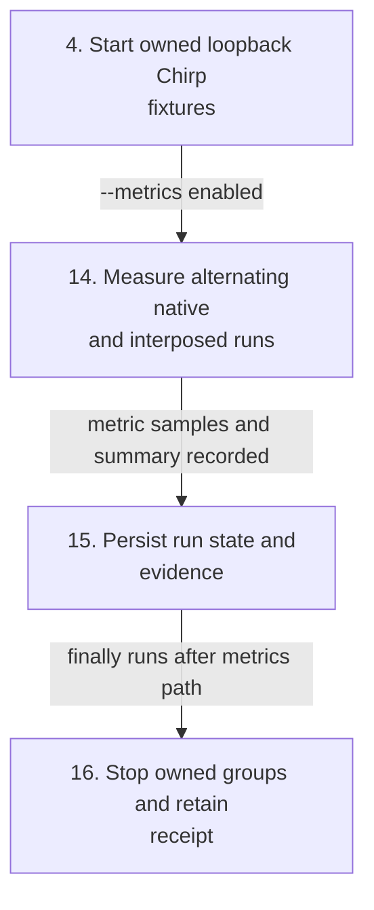
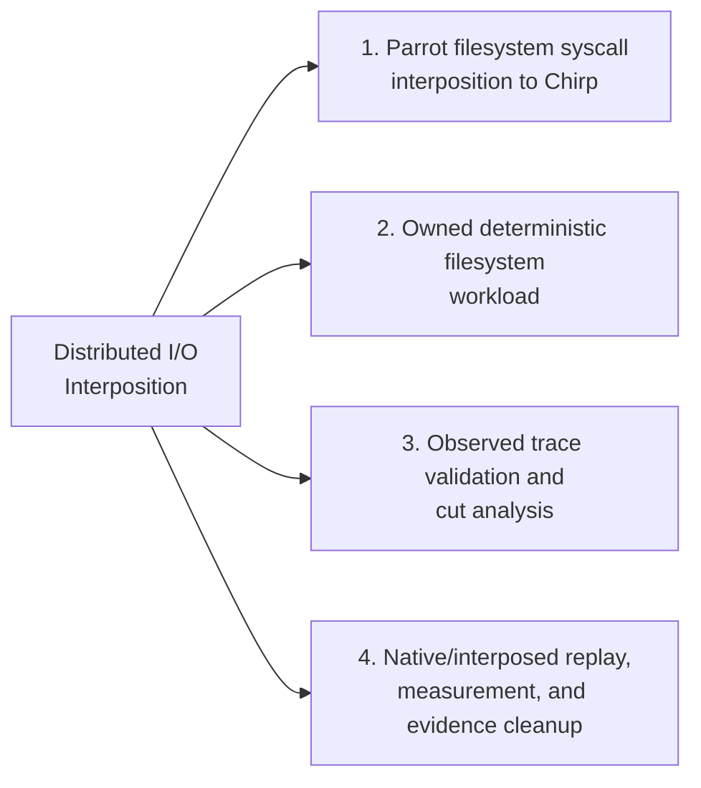
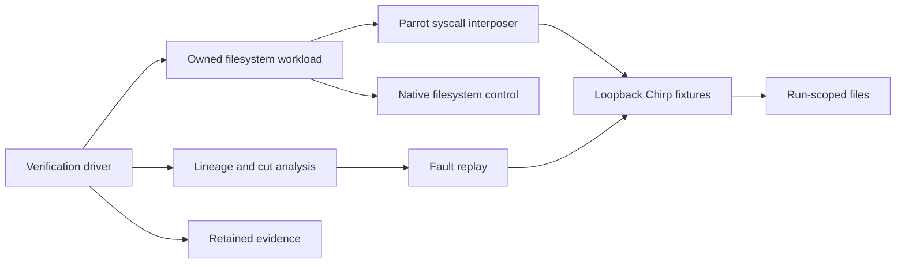
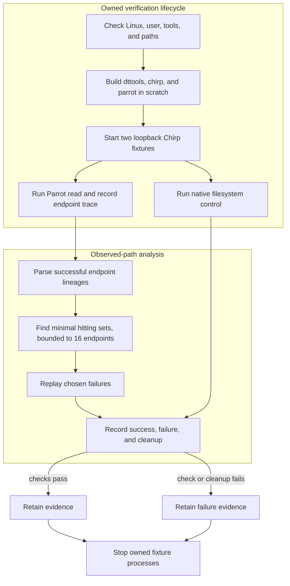

# Distributed I/O Interposition

## Contents

- [Architecture and execution guide](#architecture-and-execution-guide)
- [Implementation techniques](#implementation-techniques)
- [Native measurements](#native-measurements)
- [Source and attribution](coursework/PROVENANCE.md)

## Architecture and execution guide

<!-- execution-flow:start -->
### Execution flow

Start with the primary path, then expand a detailed workflow. Select a numbered node to see its operation, implementation techniques, and source. Solid arrows show the named control, data, or lifecycle handoff; dotted arrows show error paths. Separate entry points are named in each workflow.

<a id="review-walkthrough"></a>

#### Walk through one concrete example

Run one supported filesystem read while the owned loopback endpoint fixtures are active, then replay the captured endpoint order with endpoint A stopped.

**Trace.** [Admit a fresh supported run](#flow-step-admit-run) → [Start owned loopback Chirp fixtures](#flow-step-start-fixtures) → [Read endpoints in supplied order](#flow-step-ordered-read) → [Enumerate bounded minimal endpoint cuts](#flow-step-bound-cuts) → [Record unavailable and wrong-byte outcomes](#flow-step-failure-replays) → [Persist run state and evidence](#flow-step-persist-evidence) → [Stop owned groups and retain receipt](#flow-step-cleanup-owned).

**Result and boundary.** The trace is checked against the filesystem lifecycle, then endpoint cuts are replayed to record unavailable and wrong-byte outcomes. Owned processes are stopped and a receipt is retained; this is a bounded endpoint model, not general production fault tolerance evidence.

<details>
<summary>Implementation decisions to explain</summary>

**Why replay endpoint reads in their supplied order?** Replay preserves the observed sequence so the endpoint failure experiment tests the same ordering. It is limited to the captured trace and configured fixture behavior.

[ordered endpoint read with byte oracle](#technique-alternating-endpoint-read).

**Why enumerate bounded minimal endpoint cuts?** The bounded search identifies minimal endpoint sets whose failure intersects every relevant read path. The result depends on the configured bounds and modeled paths.

[bounded minimal hitting-set enumeration](#technique-bounded-minimal-hitting-sets).

</details>

#### Primary execution flow

The --run path admits a fresh supported environment, builds and exercises native and Parrot-backed file operations, analyzes actual successful endpoint traces, replays selected failures, and cleans up owned processes. Optional --metrics is an independent driver branch.

```mermaid
flowchart TD
n1["1. Admit a fresh supported run"]
click n1 href "https://github.com/STEVVVU/distributed-io-interposition#flow-step-admit-run" "Open step, techniques, and source" _top
n2["2. Build runtime in scratch"]
click n2 href "https://github.com/STEVVVU/distributed-io-interposition#flow-step-build-runtime" "Open step, techniques, and source" _top
n3["3. Run native lifecycle control"]
click n3 href "https://github.com/STEVVVU/distributed-io-interposition#flow-step-native-control" "Open step, techniques, and source" _top
n4["4. Start owned loopback Chirp<br/>fixtures"]
click n4 href "https://github.com/STEVVVU/distributed-io-interposition#flow-step-start-fixtures" "Open step, techniques, and source" _top
n8["8. Compare remote lifecycle with<br/>native"]
click n8 href "https://github.com/STEVVVU/distributed-io-interposition#flow-step-seed-comparison" "Open step, techniques, and source" _top
n9["9. Read endpoints in supplied<br/>order"]
click n9 href "https://github.com/STEVVVU/distributed-io-interposition#flow-step-ordered-read" "Open step, techniques, and source" _top
n11["11. Enumerate bounded minimal<br/>endpoint cuts"]
click n11 href "https://github.com/STEVVVU/distributed-io-interposition#flow-step-bound-cuts" "Open step, techniques, and source" _top
n12["12. Stop endpoint A and replay"]
click n12 href "https://github.com/STEVVVU/distributed-io-interposition#flow-step-stop-first" "Open step, techniques, and source" _top
n13["13. Record unavailable and<br/>wrong-byte outcomes"]
click n13 href "https://github.com/STEVVVU/distributed-io-interposition#flow-step-failure-replays" "Open step, techniques, and source" _top
n15["15. Persist run state and<br/>evidence"]
click n15 href "https://github.com/STEVVVU/distributed-io-interposition#flow-step-persist-evidence" "Open step, techniques, and source" _top
n16["16. Stop owned groups and retain<br/>receipt"]
click n16 href "https://github.com/STEVVVU/distributed-io-interposition#flow-step-cleanup-owned" "Open step, techniques, and source" _top
n1 -->|"supported --run and fresh scoped paths"| n2
n2 -->|"required binaries present"| n3
n3 -->|"native result checked"| n4
n8 -->|"both seeded endpoint paths provided"| n9
n11 -->|"initial cut checked before A is<br/>stopped"| n12
n12 -->|"B fallback established; then both down<br/>and wrong bytes injected"| n13
n13 -->|"results and errors update run state"| n15
n15 -->|"finally executes on success or<br/>exception"| n16
n4 -->|"run remote lifecycle and compare<br/>native bytes; detailed path below"| n8
n9 -->|"validate event log and enumerate<br/>observed cuts; detailed path below"| n11
```



**Detailed workflows.** [Trace a filesystem read and replay endpoint failures](#flow-workflow-filesystem-read-and-replay) · [Run the optional native and interposed measurement path](#flow-workflow-optional-measurement).

<a id="flow-workflow-filesystem-read-and-replay"></a>

<details>
<summary>Trace a filesystem read and replay endpoint failures</summary>

Starts at the scoped Parrot workload command. Parrot resolves supported filesystem calls to Chirp, while lineage planning consumes actual successful JSONL events and bounded replay alters only owned fixtures.

```mermaid
flowchart TD
n4["4. Start owned loopback Chirp<br/>fixtures"]
click n4 href "https://github.com/STEVVVU/distributed-io-interposition#flow-step-start-fixtures" "Open step, techniques, and source" _top
n5["5. Trace filesystem calls into<br/>Chirp"]
click n5 href "https://github.com/STEVVVU/distributed-io-interposition#flow-step-parrot-trace" "Open step, techniques, and source" _top
n6["6. Dispatch file operations to<br/>Chirp"]
click n6 href "https://github.com/STEVVVU/distributed-io-interposition#flow-step-chirp-file-ops" "Open step, techniques, and source" _top
n7["7. Check file lifecycle and<br/>bytes"]
click n7 href "https://github.com/STEVVVU/distributed-io-interposition#flow-step-checked-lifecycle" "Open step, techniques, and source" _top
n8["8. Compare remote lifecycle with<br/>native"]
click n8 href "https://github.com/STEVVVU/distributed-io-interposition#flow-step-seed-comparison" "Open step, techniques, and source" _top
n9["9. Read endpoints in supplied<br/>order"]
click n9 href "https://github.com/STEVVVU/distributed-io-interposition#flow-step-ordered-read" "Open step, techniques, and source" _top
n10["10. Validate recorded endpoint<br/>events"]
click n10 href "https://github.com/STEVVVU/distributed-io-interposition#flow-step-parse-observations" "Open step, techniques, and source" _top
n11["11. Enumerate bounded minimal<br/>endpoint cuts"]
click n11 href "https://github.com/STEVVVU/distributed-io-interposition#flow-step-bound-cuts" "Open step, techniques, and source" _top
n12["12. Stop endpoint A and replay"]
click n12 href "https://github.com/STEVVVU/distributed-io-interposition#flow-step-stop-first" "Open step, techniques, and source" _top
n13["13. Record unavailable and<br/>wrong-byte outcomes"]
click n13 href "https://github.com/STEVVVU/distributed-io-interposition#flow-step-failure-replays" "Open step, techniques, and source" _top
n15["15. Persist run state and<br/>evidence"]
click n15 href "https://github.com/STEVVVU/distributed-io-interposition#flow-step-persist-evidence" "Open step, techniques, and source" _top
n16["16. Stop owned groups and retain<br/>receipt"]
click n16 href "https://github.com/STEVVVU/distributed-io-interposition#flow-step-cleanup-owned" "Open step, techniques, and source" _top
n4 -->|"fixture endpoint path supplied to<br/>parrot_run"| n5
n5 -->|"filesystem path resolves to Chirp<br/>service"| n6
n6 -->|"remote file operation returns to<br/>workload"| n7
n7 -->|"lifecycle result and stored bytes<br/>compared"| n8
n8 -->|"both seeded endpoint paths provided"| n9
n9 -->|"JSONL event file consumed"| n10
n10 -->|"validated successful events"| n11
n11 -->|"initial cut checked before A is<br/>stopped"| n12
n12 -->|"fallback B then unavailable and<br/>wrong-byte replays"| n13
n13 -->|"results and errors update run state"| n15
n15 -->|"finally executes on success or<br/>exception"| n16
```



</details>

<a id="flow-workflow-optional-measurement"></a>

<details>
<summary>Run the optional native and interposed measurement path</summary>

This path starts only with --metrics after the driver has built the runtime and started fixture endpoints. It is a distinct mode, not a dispatcher stage in ordinary replay.



</details>

#### Steps, techniques, and source

These source traces cover the active scope below. They explain implementation behavior; benchmark results and their limits remain in the measurement sections.

<a id="flow-step-admit-run"></a>

##### 1. Admit a fresh supported run

**Component.** coursework/verify.py:main,doctor,exercise. --doctor checks Linux, non-root x86-64, tools, and paths without changing files. --run rejects an unsupported host, reused run name, invalid name, or paths outside .local before creating run-owned evidence and scratch.

**Techniques at this step.** [owned process-group cleanup with retained evidence](#technique-owned-processgroup-evidence-lifecycle).

**Source.** [`coursework/verify.py:35`](https://github.com/STEVVVU/distributed-io-interposition/blob/master/coursework/verify.py#L35) · [`coursework/verify.py:439`](https://github.com/STEVVVU/distributed-io-interposition/blob/master/coursework/verify.py#L439). [Back to execution flow](#execution-flow).

<a id="flow-step-build-runtime"></a>

##### 2. Build runtime in scratch

**Component.** coursework/verify.py:exercise. The driver copies the checkout into fresh scratch, configures it with fixed flags, builds dttools, chirp, and parrot, then checks the expected executables. A failed command or missing binary enters the exception path and retains failure state.

**Techniques at this step.** [owned process-group cleanup with retained evidence](#technique-owned-processgroup-evidence-lifecycle).

**Source.** [`coursework/verify.py:487`](https://github.com/STEVVVU/distributed-io-interposition/blob/master/coursework/verify.py#L487). [Back to execution flow](#execution-flow).

<a id="flow-step-native-control"></a>

##### 3. Run native lifecycle control

**Component.** coursework/verify.py:run_lifecycle; coursework/workload.py:lifecycle. The driver runs the deterministic lifecycle on a scratch-local native path and records its sizes, digest, and missing-file result. It then runs the ordered-read command against that native file and checks the resulting digest against the lifecycle output.

**Techniques at this step.** [checked filesystem lifecycle](#technique-checked-filesystem-lifecycle) · [differential replay with byte oracle](#technique-differential-replay-and-byte-oracle).

**Source.** [`coursework/verify.py:306`](https://github.com/STEVVVU/distributed-io-interposition/blob/master/coursework/verify.py#L306) · [`coursework/verify.py:504`](https://github.com/STEVVVU/distributed-io-interposition/blob/master/coursework/verify.py#L504) · [`coursework/workload.py:21`](https://github.com/STEVVVU/distributed-io-interposition/blob/master/coursework/workload.py#L21). [Back to execution flow](#execution-flow).

<a id="flow-step-start-fixtures"></a>

##### 4. Start owned loopback Chirp fixtures

**Component.** coursework/verify.py:ChirpEndpoint.start. The driver starts two Chirp child processes with separate scratch stores and loopback endpoints. It disables catalog advertising and tracks each owned process group; a configured failure immediately after first launch still reaches cleanup.

**Techniques at this step.** [owned process-group cleanup with retained evidence](#technique-owned-processgroup-evidence-lifecycle).

**Source.** [`coursework/verify.py:223`](https://github.com/STEVVVU/distributed-io-interposition/blob/master/coursework/verify.py#L223). [Back to execution flow](#execution-flow).

<a id="flow-step-parrot-trace"></a>

##### 5. Trace filesystem calls into Chirp

**Component.** parrot/src/tracer.c:tracer_attach,tracer_args_get; parrot/src/pfs_service.cc:pfs_service_lookup. Parrot attaches to the child with ptrace, inspects syscall stops and arguments, and resolves supported filesystem paths to a service. The /chirp path selects the Chirp service; arbitrary socket calls are not part of this filesystem path.

**Techniques at this step.** [ptrace syscall interposition](#technique-ptrace-syscall-interposition) · [filesystem service dispatch](#technique-filesystem-service-dispatch).

**Source.** [`parrot/src/tracer.c:91`](https://github.com/STEVVVU/distributed-io-interposition/blob/master/parrot/src/tracer.c#L91) · [`parrot/src/tracer.c:208`](https://github.com/STEVVVU/distributed-io-interposition/blob/master/parrot/src/tracer.c#L208) · [`parrot/src/pfs_service.cc:360`](https://github.com/STEVVVU/distributed-io-interposition/blob/master/parrot/src/pfs_service.cc#L360). [Back to execution flow](#execution-flow).

<a id="flow-step-chirp-file-ops"></a>

##### 6. Dispatch file operations to Chirp

**Component.** parrot/src/pfs_service_chirp.cc:pfs_file_chirp,pfs_service_chirp. The selected service maps file operations to Chirp client calls. The remote file object carries the handle used for reads and other supported operations, which reach the owned loopback server and its run-scoped store.

**Techniques at this step.** [filesystem service dispatch](#technique-filesystem-service-dispatch).

**Source.** [`parrot/src/pfs_service_chirp.cc:100`](https://github.com/STEVVVU/distributed-io-interposition/blob/master/parrot/src/pfs_service_chirp.cc#L100) · [`parrot/src/pfs_service_chirp.cc:196`](https://github.com/STEVVVU/distributed-io-interposition/blob/master/parrot/src/pfs_service_chirp.cc#L196). [Back to execution flow](#execution-flow).

<a id="flow-step-checked-lifecycle"></a>

##### 7. Check file lifecycle and bytes

**Component.** coursework/workload.py:lifecycle. The workload creates its directory and exclusive file, loops over partial writes, closes descriptors in finally blocks, changes directory, checks stat and read results, and verifies the missing-file errno. It returns byte counts and a SHA-256 digest for comparison.

**Techniques at this step.** [checked filesystem lifecycle](#technique-checked-filesystem-lifecycle).

**Source.** [`coursework/workload.py:21`](https://github.com/STEVVVU/distributed-io-interposition/blob/master/coursework/workload.py#L21). [Back to execution flow](#execution-flow).

<a id="flow-step-seed-comparison"></a>

##### 8. Compare remote lifecycle with native

**Component.** coursework/verify.py:exercise. For each endpoint, the driver runs lifecycle through Parrot and compares its result with the native control. It also reads the fixture file back directly and checks the expected payload bytes before recording receiver-side evidence.

**Techniques at this step.** [differential replay with byte oracle](#technique-differential-replay-and-byte-oracle).

**Source.** [`coursework/verify.py:521`](https://github.com/STEVVVU/distributed-io-interposition/blob/master/coursework/verify.py#L521). [Back to execution flow](#execution-flow).

<a id="flow-step-ordered-read"></a>

##### 9. Read endpoints in supplied order

**Component.** coursework/workload.py:read_alternates. The workload tries endpoint paths in order. An I/O error records an unavailable attempt and continues; a digest mismatch returns wrong-bytes without claiming lineage; matching bytes record the successful endpoint path.

**Techniques at this step.** [ordered endpoint read with byte oracle](#technique-alternating-endpoint-read).

**Source.** [`coursework/workload.py:76`](https://github.com/STEVVVU/distributed-io-interposition/blob/master/coursework/workload.py#L76). [Back to execution flow](#execution-flow).

<a id="flow-step-parse-observations"></a>

##### 10. Validate recorded endpoint events

**Component.** coursework/lineage.py:read_events. The analyzer parses JSONL events and rejects malformed fields, duplicate IDs or endpoints, invalid digests, inconsistent attempt results, and lineages that disagree with successful byte verification. Failed events do not become successful paths.

**Techniques at this step.** [canonical trace validation](#technique-canonical-trace-validation).

**Source.** [`coursework/lineage.py:17`](https://github.com/STEVVVU/distributed-io-interposition/blob/master/coursework/lineage.py#L17). [Back to execution flow](#execution-flow).

<a id="flow-step-bound-cuts"></a>

##### 11. Enumerate bounded minimal endpoint cuts

**Component.** coursework/lineage.py:minimal_cuts. The planner derives minimal endpoint sets that intersect every recorded successful lineage. It refuses search above the 16-endpoint bound; its output describes only paths present in the validated trace.

**Techniques at this step.** [bounded minimal hitting-set enumeration](#technique-bounded-minimal-hitting-sets).

**Source.** [`coursework/lineage.py:83`](https://github.com/STEVVVU/distributed-io-interposition/blob/master/coursework/lineage.py#L83). [Back to execution flow](#execution-flow).

<a id="flow-step-stop-first"></a>

##### 12. Stop endpoint A and replay

**Component.** coursework/verify.py:exercise,ChirpEndpoint.stop. After observing lineage A and its initial cut, the driver stops only endpoint A and reruns the same ordered read. The expected successful read from B adds the observed alternative path and changes the minimal cut for the observed paths to [A,B].

**Techniques at this step.** [differential replay with byte oracle](#technique-differential-replay-and-byte-oracle) · [owned process-group cleanup with retained evidence](#technique-owned-processgroup-evidence-lifecycle).

**Source.** [`coursework/verify.py:548`](https://github.com/STEVVVU/distributed-io-interposition/blob/master/coursework/verify.py#L548). [Back to execution flow](#execution-flow).

<a id="flow-step-failure-replays"></a>

##### 13. Record unavailable and wrong-byte outcomes

**Component.** coursework/verify.py:exercise; coursework/workload.py:read_alternates. With both endpoints stopped, replay must report unavailable and preserve the cut from successful events. The driver then serves wrong bytes from B; replay reports wrong-bytes, records no successful lineage, and leaves the cut unchanged.

**Techniques at this step.** [ordered endpoint read with byte oracle](#technique-alternating-endpoint-read) · [differential replay with byte oracle](#technique-differential-replay-and-byte-oracle).

**Source.** [`coursework/verify.py:562`](https://github.com/STEVVVU/distributed-io-interposition/blob/master/coursework/verify.py#L562) · [`coursework/workload.py:76`](https://github.com/STEVVVU/distributed-io-interposition/blob/master/coursework/workload.py#L76). [Back to execution flow](#execution-flow).

<a id="flow-step-metrics-matrix"></a>

##### 14. Measure alternating native and interposed runs

**Component.** coursework/verify.py:run_metrics; coursework/workload.py:benchmark. When --metrics is set, the driver checks free space, captures environment data, restarts owned fixtures, and alternates native and Parrot benchmark order across file sizes and trials. It verifies bytes, hashes, and metadata cleanup, then summarizes timings; this is a separate optional command path, not a stage of default replay.

**Techniques at this step.** [alternating native/interposed measurement](#technique-alternating-native-interposed-measurement).

**Source.** [`coursework/verify.py:333`](https://github.com/STEVVVU/distributed-io-interposition/blob/master/coursework/verify.py#L333) · [`coursework/workload.py:122`](https://github.com/STEVVVU/distributed-io-interposition/blob/master/coursework/workload.py#L122). [Back to execution flow](#execution-flow).

<a id="flow-step-persist-evidence"></a>

##### 15. Persist run state and evidence

**Component.** coursework/verify.py:persist_state,finalize_state. The driver writes state and command records under the run evidence directory as work proceeds. Finalization records pass state, cleanup errors, scratch removal, and whether owned processes were reaped; evidence remains after scratch cleanup.

**Techniques at this step.** [owned process-group cleanup with retained evidence](#technique-owned-processgroup-evidence-lifecycle).

**Source.** [`coursework/verify.py:107`](https://github.com/STEVVVU/distributed-io-interposition/blob/master/coursework/verify.py#L107) · [`coursework/verify.py:137`](https://github.com/STEVVVU/distributed-io-interposition/blob/master/coursework/verify.py#L137). [Back to execution flow](#execution-flow).

<a id="flow-step-cleanup-owned"></a>

##### 16. Stop owned groups and retain receipt

**Component.** coursework/verify.py:stop_process,exercise. The finally block stops endpoints and remaining tracked child process groups in reverse order, records cleanup failures, and removes scratch only after all owned processes are reaped and the path remains inside the owned root. Evidence is retained.

**Techniques at this step.** [owned process-group cleanup with retained evidence](#technique-owned-processgroup-evidence-lifecycle).

**Source.** [`coursework/verify.py:175`](https://github.com/STEVVVU/distributed-io-interposition/blob/master/coursework/verify.py#L175) · [`coursework/verify.py:618`](https://github.com/STEVVVU/distributed-io-interposition/blob/master/coursework/verify.py#L618). [Back to execution flow](#execution-flow).

<details>
<summary>Scope and subsystem coverage</summary>

coursework/verify.py --run lifecycle from host admission through Parrot-to-Chirp filesystem operations, owned workload, observed endpoint lineage, bounded cuts, selected replay, optional native/interposed measurement, and evidence cleanup.

- **Parrot filesystem syscall interposition to Chirp.** Trace attach and argument reads lead through filesystem service lookup to the inherited Chirp file implementation; arbitrary network calls are outside this path. [Step 5](#flow-step-parrot-trace), [Step 6](#flow-step-chirp-file-ops).
- **Owned deterministic filesystem workload.** The lifecycle checks filesystem outcomes and ordered reads distinguish unavailable endpoints from wrong bytes. [Step 7](#flow-step-checked-lifecycle), [Step 9](#flow-step-ordered-read).
- **Observed trace validation and cut analysis.** Only validated successful observed paths contribute to the bounded 16-endpoint minimal cut search. [Step 10](#flow-step-parse-observations), [Step 11](#flow-step-bound-cuts).
- **Native/interposed replay, measurement, and evidence cleanup.** Native control, interposed comparisons, endpoint replay, opt-in metrics, and owned process/evidence lifecycle are represented on their actual driver paths. [Step 3](#flow-step-native-control), [Step 8](#flow-step-seed-comparison), [Step 12](#flow-step-stop-first), [Step 13](#flow-step-failure-replays), [Step 14](#flow-step-metrics-matrix), [Step 15](#flow-step-persist-evidence), [Step 16](#flow-step-cleanup-owned).

Outside this flow audit:

- `Parrot socket calls, HTTP virtualization, and general network virtualization`. The mapped workflow invokes filesystem paths through the Chirp service and does not virtualize these call classes.
- `Unrelated CCTools applications and standalone examples`. They are not invoked by coursework/verify.py.
- `General LDFI or fault-tolerance certification`. The planner considers recorded successful paths only and bounds endpoint count to 16.

</details>

<!-- execution-flow:end -->

<details>
<summary>Subsystem technique index</summary>

### Subsystem map

Select a subsystem in the diagram to open its techniques, tradeoffs, and code references. The numbered links provide the same navigation. This map groups components; the execution diagrams show their runtime flow.



1. [Parrot filesystem syscall interposition to Chirp](#subsystem-parrot-filesystem-syscall-interposition-to-chirp)
2. [Owned deterministic filesystem workload](#subsystem-owned-deterministic-filesystem-workload)
3. [Observed trace validation and cut analysis](#subsystem-observed-trace-validation-and-cut-analysis)
4. [Native/interposed replay, measurement, and evidence cleanup](#subsystem-nativeinterposed-replay-measurement-and-evidence-cleanup)

This repository preserves CCTools, including the [Parrot](#parrot) syscall interposer and [Chirp](#chirp) storage service. The local extension adds an owned read workflow, [endpoint-lineage](#endpoint-lineage) analysis, a bounded cut explorer, and replay of selected failure cases. Parrot and Chirp remain inherited components; the extension does not virtualize arbitrary network calls or provide general fault-tolerance guarantees.

The diagram separates the workflow tools from the preserved runtime.

</details>

<details>
<summary>Expand flow diagram 1</summary>



</details>

The driver starts only its fixture servers, writes into fresh run roots, records successful endpoint paths, and replays bounded endpoint failures. The lineage module reduces observed paths to [minimal hitting sets](#hitting-set). Replay tests those cuts against this workload; it cannot infer paths or failure behavior that the successful run never observed. Cleanup stops only [driver-owned processes](#owned-process), while evidence remains after scratch cleanup.

<details>
<summary>Expand flow diagram 2</summary>



</details>

| Subsystem | Responsibility and owned invariant | Source |
| --- | --- | --- |
| Workload | Define deterministic file reads and expected content in owned directories | [`workload.py`](coursework/workload.py) |
| Lineage analysis | Parse endpoint observations and compute bounded minimal cuts | [`lineage.py`](coursework/lineage.py) |
| Verification lifecycle | Build required binaries, launch fixtures, execute workflows, and retain evidence | [`verify.py`](coursework/verify.py) |
| Parrot | Interpose supported filesystem syscalls and route them to Chirp | [`parrot/`](parrot/) |
| Chirp | Serve fixture file operations over loopback TCP | [`chirp/`](chirp/) |

### Trace a read and replay a cut

1. The driver checks host support and creates fresh scratch and evidence paths. It builds the required CCTools components.
2. It starts two Chirp servers on loopback and runs a native filesystem control.
3. It runs the scoped workload through Parrot. Successful calls produce endpoint observations.
4. The analyzer computes minimal sets of observed endpoints that intersect each successful path. It considers at most 16 distinct endpoints.
5. The driver stops selected fixture endpoints and replays the workload. It records success or explicit failure; existing transport retries can make fallback slow.
6. Cleanup reaps only driver-owned processes. The receipt and evidence remain available for review.

<a id="syscall-interposition"></a>
<details><summary>What is syscall interposition?</summary>

Syscall interposition redirects selected operating-system calls through another implementation. Parrot routes supported filesystem operations to Chirp; this project does not claim to virtualize `sendto` or `recvfrom`.
</details>

<a id="endpoint-lineage"></a>
<details><summary>What is endpoint lineage?</summary>

An endpoint lineage is the sequence of storage endpoints seen during a successful workload path. The analyzer uses paths actually recorded by Parrot and cannot reason about unobserved paths.
</details>

<a id="hitting-set"></a>
<details><summary>What is a hitting set?</summary>

A hitting set selects endpoints that intersect each observed successful path. The explorer enumerates minimal cuts only within its 16-endpoint bound, so results are not a general fault-tolerance proof.
</details>

<a id="chirp"></a>
<details><summary>What is Chirp?</summary>

Chirp is the CCTools storage service used as a fixture backend. The verifier binds its instances to loopback and confines files to run-specific roots.
</details>

<a id="parrot"></a>
<details><summary>What is Parrot?</summary>

Parrot is the inherited CCTools syscall interposer. This workflow redirects supported filesystem calls to Chirp over loopback TCP; HTTP requests are outside the tested scope.
</details>

<a id="owned-process"></a>
<details><summary>What is an owned process?</summary>

An owned process is a child started and tracked by this verification run. Cleanup signals only those process groups and records whether they were reaped.
</details>

### Design choices and limits

These rationales are inferred from current code and evidence, not claimed historical intent.

| Choice | Current behavior and rationale | Alternative and cost to reconsider |
| --- | --- | --- |
| Observe actual Parrot paths | Grounds analysis in operations this workload performed. | Static topology analysis could include unobserved paths but needs a complete routing model. |
| Bound cut search to 16 endpoints | Keeps the explorer finite and predictable. | A larger search needs a scalable algorithm and explicit resource bounds. |
| Use loopback fixtures | Keeps test traffic and files local to the run. | External services weaken isolation and reproducibility. |
| Keep native control beside Parrot | Compares the same scoped content operations. | A broader application workload would add different dependencies and semantics. |
| Preserve inherited retry behavior | Reports fallback latency as the runtime provides it. | Changing retries alters upstream behavior and needs a separate change and evidence. |

This project preserves the full Cooperative Computing Tools source and history, including its Parrot syscall interposer and Chirp storage service. The local extension records successful endpoint lineages from an owned read workflow, derives minimal endpoint cuts from those observed paths, and replays the workload while stopping only its loopback fixture servers.

The native runtime is Linux-only because Parrot uses `ptrace`; Windows does not emulate it. The mapped native journeys and cleanup-failure path passed on non-root Ubuntu 24.04 at commit `7c5ef0d510bb4f4c12a8999429c49081ba353805`. See the [curated run evidence](evidence/linux-39716596917/) and [hosted CI run](https://github.com/STEVVVU/distributed-io-interposition/actions/runs/39716596917). This proves those mapped journeys on that runner, not other Linux versions or arbitrary workloads. To reproduce on a compatible host:

```sh
python3 -m unittest discover -s coursework -p 'test_*.py' -v
python3 coursework/verify.py --doctor
python3 coursework/verify.py --run local-linux
```

The driver builds only `dttools`, `chirp`, and `parrot` in disposable scratch, runs native and interposed filesystem workflows against two owned loopback Chirp servers, and saves proof under `.local/evidence/<run>/`. It uses real `parrot_run` and `chirp_server`, disables external catalog interaction, writes only within fresh run roots, and retains evidence after cleanup. Its scope is file-system calls routed to Chirp over loopback TCP; it does not virtualize arbitrary socket calls such as `sendto`/`recvfrom` or provide HTTP GET virtualization. The project-local [verification skill](.agents/skills/verify-distributed-io-interposition/SKILL.md) and [feature map](.agents/skills/verify-distributed-io-interposition/features/README.md) record the proved journeys and limits.

## Implementation techniques

These cards cover the active coursework workflow and the inherited Parrot-to-Chirp filesystem path that it invokes. Rationale describes current fit in the code, not historical author intent. The interposer handles selected filesystem operations; the fixture does not virtualize arbitrary network calls.

<details>
<summary>Full technique index</summary>

| Active subsystem | Technique cards | Source |
| --- | --- | --- |
| Parrot syscall tracing | [ptrace syscall interposition](#technique-ptrace-syscall-interposition) | [`tracer.c`](parrot/src/tracer.c#L91) |
| Filesystem service dispatch to Chirp | [filesystem service dispatch](#technique-filesystem-service-dispatch) | [`pfs_service_chirp.cc`](parrot/src/pfs_service_chirp.cc#L100), [`pfs_service.cc`](parrot/src/pfs_service.cc#L360) |
| Owned deterministic filesystem workload | [checked filesystem lifecycle](#technique-checked-filesystem-lifecycle) | [`workload.py`](coursework/workload.py#L21) |
| Ordered reads over endpoint paths | [ordered endpoint read with byte oracle](#technique-alternating-endpoint-read) | [`workload.py`](coursework/workload.py#L76) |
| Trace validation and path analysis | [canonical trace validation](#technique-canonical-trace-validation), [bounded minimal hitting-set enumeration](#technique-bounded-minimal-hitting-sets) | [`lineage.py`](coursework/lineage.py#L17), [`lineage.py`](coursework/lineage.py#L83) |
| Native/interposed replay and result checks | [differential replay with byte oracle](#technique-differential-replay-and-byte-oracle) | [`verify.py`](coursework/verify.py#L439), [`workload.py`](coursework/workload.py#L76) |
| Process ownership, cleanup, and evidence | [owned process-group cleanup with retained evidence](#technique-owned-processgroup-evidence-lifecycle) | [`verify.py`](coursework/verify.py#L107), [`verify.py`](coursework/verify.py#L175) |
| Performance workload | [alternating native/interposed measurement](#technique-alternating-native-interposed-measurement) | [`verify.py`](coursework/verify.py#L333), [`workload.py`](coursework/workload.py#L122) |

</details>

<a id="subsystem-parrot-filesystem-syscall-interposition-to-chirp"></a>

### 1. Parrot filesystem syscall interposition to Chirp

[Back to the subsystem map](#architecture-and-execution-guide).

**Code.** [`parrot/src/tracer.c`](parrot/src/tracer.c), [`parrot/src/pfs_service_chirp.cc`](parrot/src/pfs_service_chirp.cc), [`parrot/src/pfs_service.cc`](parrot/src/pfs_service.cc).

**Techniques.** [ptrace syscall interposition](#technique-ptrace-syscall-interposition), [filesystem service dispatch](#technique-filesystem-service-dispatch).

**Related concepts.** [syscall interposition](#syscall-interposition), [Chirp](#chirp), [Parrot](#parrot).

<a id="technique-ptrace-syscall-interposition"></a>

<details>
<summary>ptrace syscall interposition</summary>

**Mechanism.** Parrot attaches to the child with `PTRACE_SEIZE` when available, resumes it with `PTRACE_SYSCALL`, and reads syscall numbers and arguments at stops. Its filesystem layer can replace selected operations before resuming the process. This traces system calls, not every network API or protocol.

**Example.** The owned run invokes `parrot_run` on `/chirp/127.0.0.1:<port>/...`; Python's `open`, `read`, and `stat` operations reach the traced filesystem path.

**Why here.** The fixture checks transparent filesystem calls from an unmodified workload against Chirp-backed storage.

**Tradeoffs.** `ptrace` requires the supported Linux runtime and adds process-tracing overhead. `sendto` and `recvfrom` virtualization are outside this workflow.

**Code and ownership.** Inherited CCTools code: [`tracer_attach`](parrot/src/tracer.c#L91) and [`tracer_args_get`](parrot/src/tracer.c#L208).


**Used in.** [Parrot filesystem syscall interposition to Chirp](#subsystem-parrot-filesystem-syscall-interposition-to-chirp). [Back to the subsystem map](#architecture-and-execution-guide).

</details>

<a id="technique-filesystem-service-dispatch"></a>

<details>
<summary>filesystem service dispatch</summary>

**Mechanism.** Parrot resolves a path to a filesystem service, then the Chirp service maps file operations to `chirp_global_*` calls. `pfs_file_chirp` holds the remote file handle and implements operations such as read, write, stat, and close.

**Example.** Opening a `/chirp/host:port/path` yields a Chirp file object; its `read` method requests bytes from that server.

**Why here.** The same POSIX-style calls used by the native workload can run over the existing Chirp client implementation.

**Tradeoffs.** The supported service operations and the Chirp protocol define what paths can do. Loopback fixture evidence does not establish remote network virtualization or behavior for every service method.

**Code and ownership.** Inherited CCTools code: [`pfs_file_chirp`](parrot/src/pfs_service_chirp.cc#L100), [`pfs_service_chirp`](parrot/src/pfs_service_chirp.cc#L196), and [`pfs_service_lookup`](parrot/src/pfs_service.cc#L360).


**Used in.** [Parrot filesystem syscall interposition to Chirp](#subsystem-parrot-filesystem-syscall-interposition-to-chirp). [Back to the subsystem map](#architecture-and-execution-guide).

</details>

<a id="subsystem-owned-deterministic-filesystem-workload"></a>

### 2. Owned deterministic filesystem workload

[Back to the subsystem map](#architecture-and-execution-guide).

**Code.** [`coursework/workload.py`](coursework/workload.py).

**Techniques.** [checked filesystem lifecycle](#technique-checked-filesystem-lifecycle), [ordered endpoint read with byte oracle](#technique-alternating-endpoint-read).

**Related concepts.** [Parrot](#parrot).

<a id="technique-checked-filesystem-lifecycle"></a>

<details>
<summary>checked filesystem lifecycle</summary>

**Mechanism.** `lifecycle` creates a run-owned directory and exclusive file, handles partial writes in a loop, closes descriptors in `finally` blocks, changes directory, stats and reads the file, and checks the missing-file errno. It returns sizes and a SHA-256 digest for comparison.

**Example.** The fixture writes `PAYLOAD`, reads it back, then requires the digest, byte count, stat size, and `ENOENT` result to match expectations.

**Why here.** A compact deterministic path exercises directory, metadata, descriptor, data, and error behavior under native I/O and Parrot.

**Tradeoffs.** This lifecycle proves only the operations it invokes. It does not cover concurrent writers, durability via `fsync`, or arbitrary application behavior.

**Code and ownership.** Coursework extension: [`lifecycle`](coursework/workload.py#L21).


**Used in.** [Owned deterministic filesystem workload](#subsystem-owned-deterministic-filesystem-workload). [Back to the subsystem map](#architecture-and-execution-guide).

</details>

<a id="technique-alternating-endpoint-read"></a>

<details>
<summary>ordered endpoint read with byte oracle</summary>

**Mechanism.** `read_alternates` tries endpoint paths in the supplied order. An I/O error records an unavailable attempt and continues. A successful read is accepted only when its SHA-256 matches the expected digest; it then records that endpoint as the lineage. Wrong bytes stop the read and remain distinct from unavailability.

**Example.** With A unavailable and B serving the expected bytes, the trace stores both attempts and the successful lineage `B`.

**Why here.** The result connects a concrete read outcome to the endpoint that supplied the checked content.

**Tradeoffs.** This is sequential client fallback for reads. It does not heal servers or promise a bounded failover time under Parrot's inherited retry behavior.

**Code and ownership.** Coursework extension: [`read_alternates`](coursework/workload.py#L76).


**Used in.** [Owned deterministic filesystem workload](#subsystem-owned-deterministic-filesystem-workload). [Back to the subsystem map](#architecture-and-execution-guide).

</details>

<a id="subsystem-observed-trace-validation-and-cut-analysis"></a>

### 3. Observed trace validation and cut analysis

[Back to the subsystem map](#architecture-and-execution-guide).

**Code.** [`coursework/lineage.py`](coursework/lineage.py), [`coursework/test_lineage.py`](coursework/test_lineage.py).

**Techniques.** [canonical trace validation](#technique-canonical-trace-validation), [bounded minimal hitting-set enumeration](#technique-bounded-minimal-hitting-sets).

<a id="technique-canonical-trace-validation"></a>

<details>
<summary>canonical trace validation</summary>

**Mechanism.** `read_events` parses JSON Lines and rejects malformed objects, duplicate request IDs or endpoints, invalid digests, inconsistent attempt outcomes, and lineages that disagree with the final successful endpoint. A successful event must match the expected digest. Failed events cannot carry a lineage.

**Example.** An event claiming success with a different digest is rejected before the planner sees it.

**Why here.** The cut search consumes trace data; schema and oracle checks prevent malformed or failed attempts from appearing as successful paths.

**Tradeoffs.** Validation checks the recorded event structure and digest relationship. It does not independently prove that a trace file came from a trusted process.

**Code and ownership.** Coursework extension: [`read_events`](coursework/lineage.py#L17), with deterministic rejection cases in [`LineageTests`](coursework/test_lineage.py#L25).


**Used in.** [Observed trace validation and cut analysis](#subsystem-observed-trace-validation-and-cut-analysis). [Back to the subsystem map](#architecture-and-execution-guide).

</details>

<a id="technique-bounded-minimal-hitting-sets"></a>

<details>
<summary>bounded minimal hitting-set enumeration</summary>

**Mechanism.** `minimal_cuts` forms the distinct endpoint set from successful lineages, rejects empty paths and sets larger than 16, then enumerates endpoint combinations by increasing width. It skips any candidate containing an already found cut and keeps candidates that intersect every observed path.

**Example.** Paths `[A]` and `[B]` produce the minimal cut `[A, B]`; paths `[A, B]` and `[A, C]` produce `[A]` and `[B, C]`.

**Why here.** The bounded search proposes endpoint sets that the driver can replay against the observed workload.

**Tradeoffs.** Combination enumeration is practical only within the explicit endpoint cap. Results cover captured successful paths, not unobserved execution or general fault tolerance.

**Code and ownership.** Coursework extension: [`minimal_cuts`](coursework/lineage.py#L83), exercised by [`LineageTests`](coursework/test_lineage.py#L30).


**Used in.** [Observed trace validation and cut analysis](#subsystem-observed-trace-validation-and-cut-analysis). [Back to the subsystem map](#architecture-and-execution-guide).

</details>

<a id="subsystem-nativeinterposed-replay-measurement-and-evidence-cleanup"></a>

### 4. Native/interposed replay, measurement, and evidence cleanup

[Back to the subsystem map](#architecture-and-execution-guide).

**Code.** [`coursework/verify.py`](coursework/verify.py), [`coursework/test_workload.py`](coursework/test_workload.py).

**Techniques.** [differential replay with byte oracle](#technique-differential-replay-and-byte-oracle), [owned process-group cleanup with retained evidence](#technique-owned-processgroup-evidence-lifecycle), [alternating native/interposed measurement](#technique-alternating-native-interposed-measurement).

**Related concepts.** [Chirp](#chirp), [Parrot](#parrot), [owned process](#owned-process).

<a id="technique-differential-replay-and-byte-oracle"></a>

<details>
<summary>differential replay with byte oracle</summary>

**Mechanism.** The driver runs the lifecycle natively and through Parrot, compares result objects, and reads each receiver's stored bytes. It then stops an owned endpoint, reruns the ordered read, parses the captured trace, derives a cut, and replays endpoint failures. The digest distinguishes expected content, wrong bytes, and unavailable reads.

**Example.** After A is stopped, a real successful B read adds lineage `B`; the derived `[A, B]` cut then makes the read unavailable when both fixture servers are stopped.

**Why here.** This joins runtime behavior with observed traces instead of feeding a hard-coded failure matrix to the planner.

**Tradeoffs.** Replays cover the fixed workload and observed endpoint paths. They do not establish failure behavior for other paths or workloads.

**Code and ownership.** Coursework extension: [`exercise`](coursework/verify.py#L439), [`run_lifecycle`](coursework/verify.py#L306), and [`read_alternates`](coursework/workload.py#L76).


**Used in.** [Native/interposed replay, measurement, and evidence cleanup](#subsystem-nativeinterposed-replay-measurement-and-evidence-cleanup). [Back to the subsystem map](#architecture-and-execution-guide).

</details>

<a id="technique-owned-processgroup-evidence-lifecycle"></a>

<details>
<summary>owned process-group cleanup with retained evidence</summary>

**Mechanism.** The driver starts each child in a new session, records its process group, and atomically persists state. Cleanup signals and waits for only registered children. It removes the fresh scratch tree only after all owned processes are reaped; evidence is stored separately and retained. A passing result requires both behavior and cleanup success.

**Example.** The injected post-launch failure exits unsuccessfully but records stopped processes, successful cleanup, and retained failure evidence.

**Why here.** Fixture servers and build artifacts need a bounded lifetime without erasing the records used to diagnose a failure.

**Tradeoffs.** A process the driver cannot reap makes cleanup fail and prevents a passing result. A process surviving an interrupted driver may need inspection using its recorded PID and command line.

**Code and ownership.** Coursework extension: [`persist_state`](coursework/verify.py#L107), [`stop_process`](coursework/verify.py#L175), and [`finalize_state`](coursework/verify.py#L137).


**Used in.** [Native/interposed replay, measurement, and evidence cleanup](#subsystem-nativeinterposed-replay-measurement-and-evidence-cleanup). [Back to the subsystem map](#architecture-and-execution-guide).

</details>

<a id="technique-alternating-native-interposed-measurement"></a>

<details>
<summary>alternating native/interposed measurement</summary>

**Mechanism.** The optional metrics path uses bounded file-size, file-count, and metadata-cycle inputs. It warms each mode, alternates native and interposed trial order, times write, read-with-hash, and metadata phases, then checks receiver sizes and hashes outside the timed region. The results retain samples and environment details for summaries.

**Example.** Each trial writes and reads deterministic blocks, verifies the remote receiver, and removes only its owned payload directory after validation.

**Why here.** Alternating order exposes both execution paths under the same workload and captures the cost of this fixture setup.

**Tradeoffs.** Reads follow writes with warm caches, files are closed without `fsync`, and the live Chirp server is outside client/Parrot resource accounting. These measurements do not describe durable storage or general network capacity.

**Code and ownership.** Coursework extension: [`run_metrics`](coursework/verify.py#L333) and [`benchmark`](coursework/workload.py#L122).


**Used in.** [Native/interposed replay, measurement, and evidence cleanup](#subsystem-nativeinterposed-replay-measurement-and-evidence-cleanup). [Back to the subsystem map](#architecture-and-execution-guide).

</details>

## Native measurements

[Run 39728898971](https://github.com/STEVVVU/distributed-io-interposition/actions/runs/39728898971)
measured source `e497cbb6f570dfa526cafd6bf8ea3abef02a2357` on Ubuntu 24.04,
an AMD EPYC 7763 VM with four logical CPUs, GCC 13.3 and Python 3.12. Five
alternating native/Parrot pairs followed one warmup per side. All 30 measured
byte workloads and 15 measured availability states passed their expected
outcomes; receiver hashes and owned-process cleanup passed.

For sixteen 16 MiB files (256 MiB total), medians (full ranges) were:

| Measurement | Native local filesystem | Parrot over loopback Chirp |
| --- | ---: | ---: |
| Write and close, MB/s | 3760 (3730..3800) | 195 (173..206) |
| Read with SHA256, MB/s | 1411 (1401..1415) | 187 (165..206) |
| 1000 metadata cycles, seconds | 0.0342 (0.0340..0.0347) | 2.206 (1.827..2.324) |
| Whole command, seconds | 0.369 (0.368..0.369) | 5.179 (4.678..5.679) |

Each metadata cycle exclusively creates, closes, stats and unlinks one empty
file. Reads follow writes with warm filesystem caches. Files are closed without
fsync, so these are application I/O measurements with hashing, not durable disk
or network capacity. Whole-command time includes Python/Parrot launch and
verification receipt overhead. Interposition is slower than native local I/O
in this fixture; these values support no general performance advantage.

The sequential alternate reader, with the existing five-second Parrot timeout,
took 5.163 (4.905..5.517) ms with both endpoints available, 10017.405
(10016.618..10018.407) ms with A down and B succeeding, and 20023.529
(20023.429..20023.612) ms to return explicit failure with both down. These are
five-trial median/ranges for the read, excluding process startup and trace
fsync. Fallback is slow under the preserved transport retry behavior; it does
not provide automatic service recovery.

Reproduce all sizes, metadata and fault-state measurements with:

```sh
python3 coursework/verify.py --run fresh-metrics --metrics
```

[Complete compact results and raw hashes](evidence/linux-39728898971/) retain
all sizes and states, source identity, resource scope, separate trace and
limitations. Client/Parrot CPU and RSS exclude the live Chirp server, so a total
system bottleneck has not been established. No runtime retry limit was changed.

The fault explorer is intentionally bounded to at most 16 distinct endpoints. Its minimal hitting sets describe cuts over observed successful paths only; they are hypotheses for this run, not a proof of general fault tolerance. See [coursework/PROVENANCE.md](coursework/PROVENANCE.md) for source and research attribution, and [README.upstream.md](README.upstream.md) for the preserved CCTools README.

This project is distributed under GNU GPL version 2 as a whole, consistent with the preserved upstream application. See [COPYING](COPYING) and the original per-file notices.
