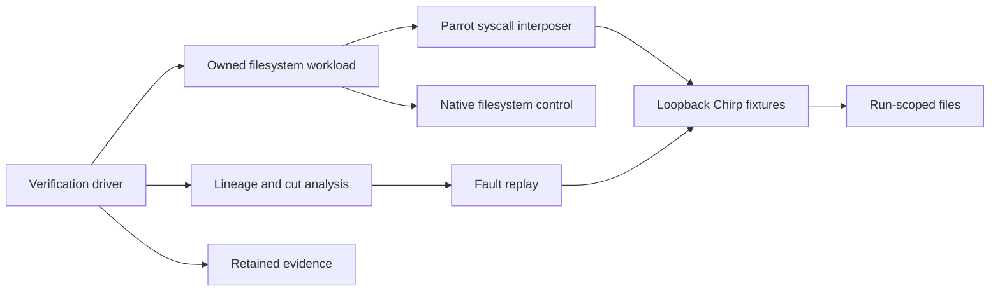
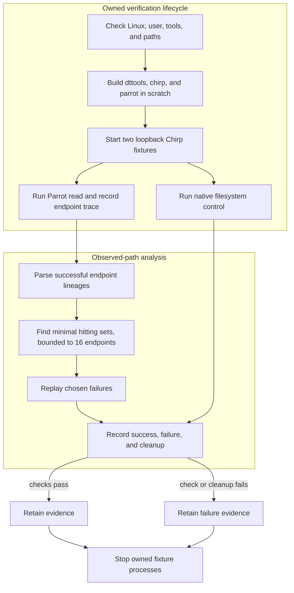

# Distributed I/O Interposition

## Contents

- [Architecture and execution guide](#architecture-and-execution-guide)
- [Native measurements](#native-measurements)
- [Source and attribution](coursework/PROVENANCE.md)

## Architecture and execution guide

This repository preserves CCTools, including the [Parrot](#parrot) syscall interposer and [Chirp](#chirp) storage service. The local extension adds an owned read workflow, [endpoint-lineage](#endpoint-lineage) analysis, a bounded cut explorer, and replay of selected failure cases. Parrot and Chirp remain inherited components; the extension does not virtualize arbitrary network calls or provide general fault-tolerance guarantees.

The diagram separates the workflow tools from the preserved runtime.



The driver starts only its fixture servers, writes into fresh run roots, records successful endpoint paths, and replays bounded endpoint failures. The lineage module reduces observed paths to [minimal hitting sets](#hitting-set). Replay tests those cuts against this workload; it cannot infer paths or failure behavior that the successful run never observed. Cleanup stops only [driver-owned processes](#owned-process), while evidence remains after scratch cleanup.



| Subsystem | Responsibility and owned invariant | Source |
| --- | --- | --- |
| Workload | Define deterministic file reads and expected content in owned directories | [`workload.py`](coursework/workload.py) |
| Lineage analysis | Parse endpoint observations and compute bounded minimal cuts | [`lineage.py`](coursework/lineage.py) |
| Verification lifecycle | Build required binaries, launch fixtures, execute workflows, and retain evidence | [`verify.py`](coursework/verify.py) |
| Parrot | Interpose supported filesystem syscalls and route them to Chirp | [`parrot/`](parrot/) |
| Chirp | Serve fixture file operations over loopback TCP | [`chirp/`](chirp/) |

### Trace a read and replay a cut

1. The driver checks host support and creates fresh scratch and evidence paths. It builds the required CCTools components.
2. It starts two Chirp servers on loopback and runs a native filesystem control.
3. It runs the scoped workload through Parrot. Successful calls produce endpoint observations.
4. The analyzer computes minimal sets of observed endpoints that intersect each successful path. It considers at most 16 distinct endpoints.
5. The driver stops selected fixture endpoints and replays the workload. It records success or explicit failure; existing transport retries can make fallback slow.
6. Cleanup reaps only driver-owned processes. The receipt and evidence remain available for review.

<a id="syscall-interposition"></a>
<details><summary>What is syscall interposition?</summary>

Syscall interposition redirects selected operating-system calls through another implementation. Parrot routes supported filesystem operations to Chirp; this project does not claim to virtualize `sendto` or `recvfrom`.
</details>

<a id="endpoint-lineage"></a>
<details><summary>What is endpoint lineage?</summary>

An endpoint lineage is the sequence of storage endpoints seen during a successful workload path. The analyzer uses paths actually recorded by Parrot and cannot reason about unobserved paths.
</details>

<a id="hitting-set"></a>
<details><summary>What is a hitting set?</summary>

A hitting set selects endpoints that intersect each observed successful path. The explorer enumerates minimal cuts only within its 16-endpoint bound, so results are not a general fault-tolerance proof.
</details>

<a id="chirp"></a>
<details><summary>What is Chirp?</summary>

Chirp is the CCTools storage service used as a fixture backend. The verifier binds its instances to loopback and confines files to run-specific roots.
</details>

<a id="parrot"></a>
<details><summary>What is Parrot?</summary>

Parrot is the inherited CCTools syscall interposer. This workflow redirects supported filesystem calls to Chirp over loopback TCP; HTTP requests are outside the tested scope.
</details>

<a id="owned-process"></a>
<details><summary>What is an owned process?</summary>

An owned process is a child started and tracked by this verification run. Cleanup signals only those process groups and records whether they were reaped.
</details>

### Design choices and limits

These rationales are inferred from current code and evidence, not claimed historical intent.

| Choice | Current behavior and rationale | Alternative and cost to reconsider |
| --- | --- | --- |
| Observe actual Parrot paths | Grounds analysis in operations this workload performed. | Static topology analysis could include unobserved paths but needs a complete routing model. |
| Bound cut search to 16 endpoints | Keeps the explorer finite and predictable. | A larger search needs a scalable algorithm and explicit resource bounds. |
| Use loopback fixtures | Keeps test traffic and files local to the run. | External services weaken isolation and reproducibility. |
| Keep native control beside Parrot | Compares the same scoped content operations. | A broader application workload would add different dependencies and semantics. |
| Preserve inherited retry behavior | Reports fallback latency as the runtime provides it. | Changing retries alters upstream behavior and needs a separate change and evidence. |

This project preserves the full Cooperative Computing Tools source and history, including its Parrot syscall interposer and Chirp storage service. The local extension records successful endpoint lineages from an owned read workflow, derives minimal endpoint cuts from those observed paths, and replays the workload while stopping only its loopback fixture servers.

The native runtime is Linux-only because Parrot uses `ptrace`; Windows does not emulate it. The mapped native journeys and cleanup-failure path passed on non-root Ubuntu 24.04 at commit `7c5ef0d510bb4f4c12a8999429c49081ba353805`. See the [curated run evidence](evidence/linux-39716596917/) and [hosted CI run](https://github.com/STEVVVU/distributed-io-interposition/actions/runs/39716596917). This proves those mapped journeys on that runner, not other Linux versions or arbitrary workloads. To reproduce on a compatible host:

```sh
python3 -m unittest discover -s coursework -p 'test_*.py' -v
python3 coursework/verify.py --doctor
python3 coursework/verify.py --run local-linux
```

The driver builds only `dttools`, `chirp`, and `parrot` in disposable scratch, runs native and interposed filesystem workflows against two owned loopback Chirp servers, and saves proof under `.local/evidence/<run>/`. It uses real `parrot_run` and `chirp_server`, disables external catalog interaction, writes only within fresh run roots, and retains evidence after cleanup. Its scope is file-system calls routed to Chirp over loopback TCP; it does not virtualize arbitrary socket calls such as `sendto`/`recvfrom` or provide HTTP GET virtualization. The project-local [verification skill](.agents/skills/verify-distributed-io-interposition/SKILL.md) and [feature map](.agents/skills/verify-distributed-io-interposition/features/README.md) record the proved journeys and limits.

## Native measurements

[Run 39728898971](https://github.com/STEVVVU/distributed-io-interposition/actions/runs/39728898971)
measured source `e497cbb6f570dfa526cafd6bf8ea3abef02a2357` on Ubuntu 24.04,
an AMD EPYC 7763 VM with four logical CPUs, GCC 13.3 and Python 3.12. Five
alternating native/Parrot pairs followed one warmup per side. All 30 measured
byte workloads and 15 measured availability states passed their expected
outcomes; receiver hashes and owned-process cleanup passed.

For sixteen 16 MiB files (256 MiB total), medians (full ranges) were:

| Measurement | Native local filesystem | Parrot over loopback Chirp |
| --- | ---: | ---: |
| Write and close, MB/s | 3760 (3730..3800) | 195 (173..206) |
| Read with SHA256, MB/s | 1411 (1401..1415) | 187 (165..206) |
| 1000 metadata cycles, seconds | 0.0342 (0.0340..0.0347) | 2.206 (1.827..2.324) |
| Whole command, seconds | 0.369 (0.368..0.369) | 5.179 (4.678..5.679) |

Each metadata cycle exclusively creates, closes, stats and unlinks one empty
file. Reads follow writes with warm filesystem caches. Files are closed without
fsync, so these are application I/O measurements with hashing, not durable disk
or network capacity. Whole-command time includes Python/Parrot launch and
verification receipt overhead. Interposition is slower than native local I/O
in this fixture; these values support no general performance advantage.

The sequential alternate reader, with the existing five-second Parrot timeout,
took 5.163 (4.905..5.517) ms with both endpoints available, 10017.405
(10016.618..10018.407) ms with A down and B succeeding, and 20023.529
(20023.429..20023.612) ms to return explicit failure with both down. These are
five-trial median/ranges for the read, excluding process startup and trace
fsync. Fallback is slow under the preserved transport retry behavior; it does
not provide automatic service recovery.

Reproduce all sizes, metadata and fault-state measurements with:

```sh
python3 coursework/verify.py --run fresh-metrics --metrics
```

[Complete compact results and raw hashes](evidence/linux-39728898971/) retain
all sizes and states, source identity, resource scope, separate trace and
limitations. Client/Parrot CPU and RSS exclude the live Chirp server, so a total
system bottleneck has not been established. No runtime retry limit was changed.

The fault explorer is intentionally bounded to at most 16 distinct endpoints. Its minimal hitting sets describe cuts over observed successful paths only; they are hypotheses for this run, not a proof of general fault tolerance. See [coursework/PROVENANCE.md](coursework/PROVENANCE.md) for source and research attribution, and [README.upstream.md](README.upstream.md) for the preserved CCTools README.

This project is distributed under GNU GPL version 2 as a whole, consistent with the preserved upstream application. See [COPYING](COPYING) and the original per-file notices.
